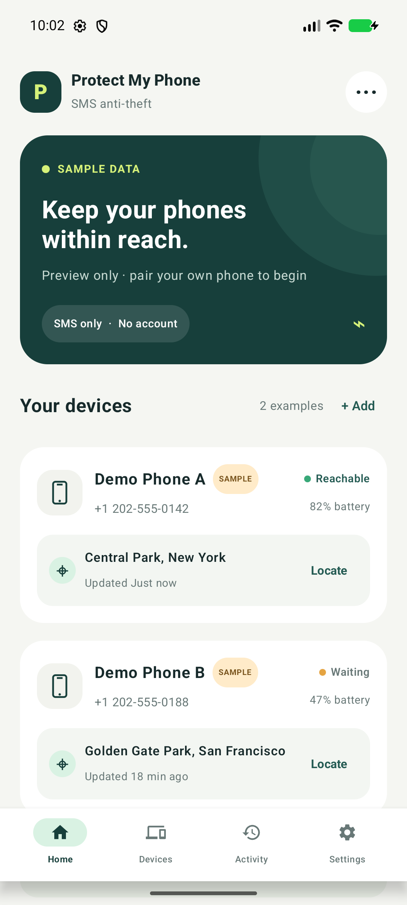
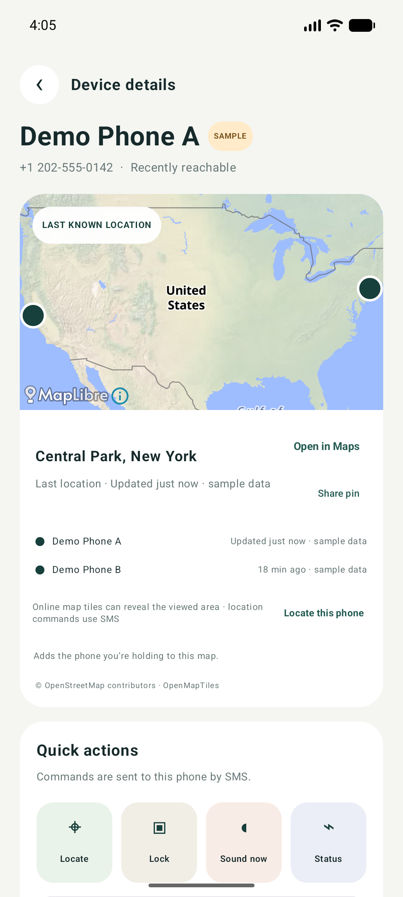
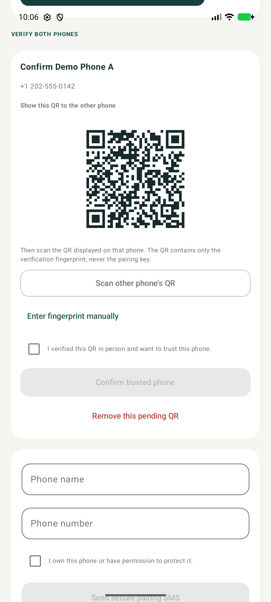
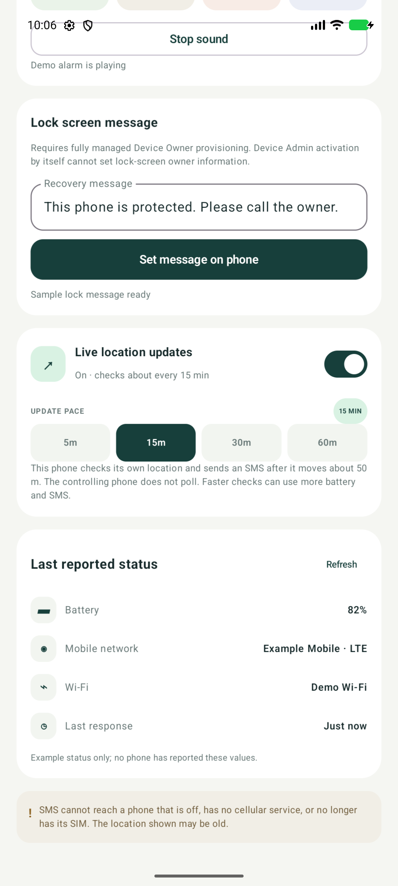
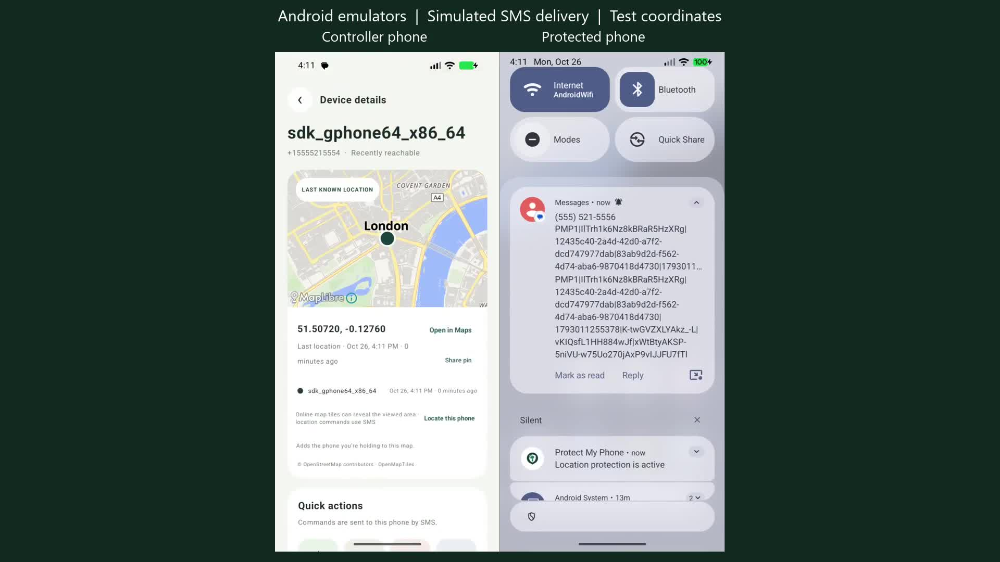

<div align="center">


# Protect My Phone

**Your phones. Connected by SMS.**

An open-source Android companion for finding and securing phones you own.
Pair trusted devices, request their location and status, sound an alert, or send a lock request—without an app account or command server.

[](https://github.com/codeterrayt/protect-my-phone-android-app/releases/latest/download/Protect-My-Phone.apk)
[](https://www.rohanprajapati.dev/products/protect-my-phone)

[](https://github.com/codeterrayt/protect-my-phone-android-app/releases)


[](LICENSE)
[](https://github.com/codeterrayt/protect-my-phone-android-app/issues)

</div>

## Get the app

Download the **signed release APK** from [GitHub Releases](https://github.com/codeterrayt/protect-my-phone-android-app/releases/latest). Install it on each phone you want to pair. Android 8.0 or later and working SMS service are required. Carrier charges, including multipart SMS charges, may apply.

This is an early release. Test pairing and the features you need on your own phones before relying on them.

> [!WARNING]
> **Use only with informed consent.** Install and pair devices you own or have explicit permission to manage. Everyone using a paired phone must understand its location-sharing and remote-control features. Never use this app for covert tracking, stalking, harassment or monitoring without consent. Remove pairings when consent is withdrawn. Keep phone numbers, locations, pairing codes and message contents out of public reports.

## Screenshots

Actual Android app screenshots, captured from the separate demo build with fictional devices, phone numbers, locations and QR data.

| Your paired phones | Location and device details |
| :---: | :---: |
|  |  |
| **Verify a pairing** | **Movement updates and status** |
|  |  |

[](https://youtu.be/unJQ_c7WJkg)

The release walkthrough shows permission setup, background location updates and Stop on two Android emulators. SMS delivery is simulated using the app's actual authenticated messages; all identities and coordinates are test data.

## Features

| Feature | What you can do |
| --- | --- |
| Verified pairing | Connect multiple phones through SMS, compare QR-assisted fingerprints and approve trust on both devices. |
| Combined status | Request available battery, mobile network, Wi-Fi, last location and response information together. |
| One-time location | Request a location and view its timestamp, including the last available report. |
| Movement updates | Start updates once. The protected phone checks its own location and sends changed positions at the selected interval and movement threshold. Send Stop to end updates. |
| Maps | View device markers on the in-app map or open a reported location in another maps app. |
| Find-phone sound | Start or stop an audible alert from a paired phone. |
| Remote lock | Send a lock request after the receiving owner enables Android Device Admin. |
| Recovery message | Display custom lock-screen owner text on devices provisioned with Device Owner management. |

The command channel uses cellular SMS. Internet access is needed for online map tiles. Android permissions and device settings affect which features are available.

## Install

1. Download **Protect-My-Phone.apk** from the [latest release](https://github.com/codeterrayt/protect-my-phone-android-app/releases/latest). The release also includes a SHA-256 checksum.
2. Open the APK. If prompted, allow your browser or file manager to **install unknown apps**, then return to the installer. Menu names vary by manufacturer.
3. Open **Protect My Phone** and read the setup disclosures. Enable SMS access for commands. Enable location, notifications and optional remote lock when you choose those features.
4. Install on the second phone. Start pairing, enter the other phone's number, verify the displayed fingerprints using the QR flow, and approve the pairing on both phones.
5. Send a status request and test location and sound. Keep both phones powered on with SMS service available.

After installation, turn off the install permission for the browser or file manager if it is no longer needed. Install updates over the existing app with the same signature to preserve local data. Uninstalling first removes local pairings.

### Play Protect warnings

Download the official signed APK from Code Terra using the release link above. The source code is public, and each release includes a checksum to verify your download.

Protect My Phone uses SMS to exchange recovery commands between your paired phones. Location sharing and remote lock are features you choose to enable. Play Protect can show a warning for apps installed outside Google Play that request permissions such as SMS.

Google Play's distribution policy separately excludes SMS-based device locators and remote phone control. The current SMS edition is distributed here as an APK. See [Google's SMS policy](https://support.google.com/googleplay/android-developer/answer/10208820) and [Play Protect guidance](https://support.google.com/googleplay/answer/2812853).

If Play Protect blocks installation and you choose to continue with the official APK:

1. Open **Play Store → profile picture → Play Protect → Settings**.
2. Turn off **Scan apps with Play Protect**, then retry installation.
3. Turn scanning back on afterward.

Turning scanning off temporarily reduces protection for your phone. **Keep it enabled afterward.** Use only the official release linked above.

### Install with ADB

With [Android Platform Tools](https://developer.android.com/tools/releases/platform-tools) installed, enable USB debugging on your phone and approve your computer, then run:

```sh
adb devices -l
adb install -r Protect-My-Phone.apk
```

Turn debugging off after use if you no longer need it. A signature mismatch requires the original signing identity; uninstalling to replace it erases local app data.

## Privacy and permissions

Pairings, settings and the latest reported device information are stored locally. SMS commands and replies are authenticated and encrypted at the application layer after pairing; carriers still handle phone numbers, delivery metadata and encrypted payloads.

| Access | Purpose |
| --- | --- |
| SMS | Receive paired-device commands and send replies. |
| Location | Retrieve a position; optional background access supports opted-in updates while the app is not visible. |
| Notifications | Show the ongoing location-service notification and app status. |
| Camera | Scan a pairing QR code. |
| Network/Wi-Fi state | Include available connection details in a status response. |
| Device Admin | Optional owner-approved screen locking. |
| Device Owner | Optional advanced managed-device provisioning for recovery text. |

Maps use MapLibre and OpenFreeMap. Tile requests expose the IP address and viewed map area to providers. QR scanning uses Google ML Kit, whose SDK can send installation identifiers, device/app information and diagnostic/usage events to Google. The project operates no command server or app-account service. Read the [privacy policy](https://www.rohanprajapati.dev/products/protect-my-phone/privacy) and [third-party notices](THIRD_PARTY_NOTICES.md).

## Build from source

Use Android Studio or the included Gradle wrapper with a JDK compatible with the Android Gradle Plugin, Android SDK platform 37 and the required SDK build tools. Local release verification used JDK 22; the app targets Java 17 bytecode.

```sh
git clone https://github.com/codeterrayt/protect-my-phone-android-app.git
cd protect-my-phone-android-app
./gradlew :app:assembleDebug :app:testDebugUnitTest
```

On Windows, replace `./gradlew` with `.\gradlew.bat`. Debug APK: `app/build/outputs/apk/debug/app-debug.apk`.

For a signed release, configure your own key in your **user-level** Gradle properties or secure environment:

```properties
PROTECT_MY_PHONE_RELEASE_STORE_FILE=/absolute/path/to/your-key.jks
PROTECT_MY_PHONE_RELEASE_STORE_PASSWORD=your-store-password
PROTECT_MY_PHONE_RELEASE_KEY_ALIAS=your-key-alias
PROTECT_MY_PHONE_RELEASE_KEY_PASSWORD=your-key-password
```

```sh
./gradlew :app:assembleRelease
```

Signing keys and credentials are excluded from this repository. Safeguard your key: updates to your own builds must use the same signing identity.

The separate `demo` variant installs alongside the app and provides fictional data for screenshots:

```sh
./gradlew :app:assembleDemo
```

## Contribute

Help improve device compatibility, accessibility, documentation, tests or the interface. Start with the [contribution guide](CONTRIBUTING.md), open an [issue](https://github.com/codeterrayt/protect-my-phone-android-app/issues), or submit a focused pull request. Include your Android version and device model; remove personal information from logs and screenshots.

For vulnerabilities, follow [SECURITY.md](SECURITY.md) rather than posting sensitive details publicly. Independent reviews of the pairing and SMS protocol are welcome.

## License

Released under the [Apache License 2.0](LICENSE). Third-party libraries, map data and services retain their own licenses and terms; see [THIRD_PARTY_NOTICES.md](THIRD_PARTY_NOTICES.md).

Built by **Code Terra**. Contributions are welcome.
